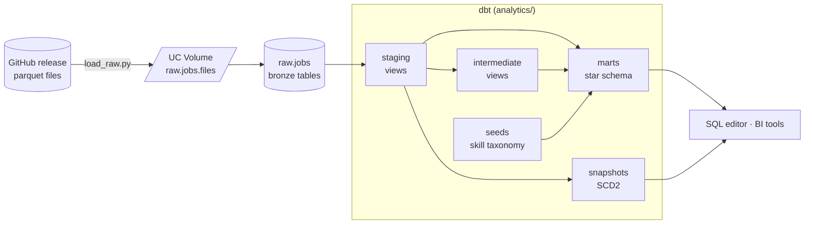

# Job Postings Pipeline: dbt + Databricks

[](https://joanasoares0.github.io/dbt-databricks-pipeline/)


An end-to-end analytics engineering pipeline on **Databricks**. It takes a year of raw job-posting scrapes (July 2025 – June 2026), ingests them into Unity Catalog, models them with dbt into a tested star schema, versions them with SCD2 snapshots, and rebuilds everything on a scheduled Databricks Job.

- **Ingests** 12 monthly parquet files and a skills file straight from GitHub into a Unity Catalog Volume, with no local files
- **Models** medallion layers into a star schema (fact, dimensions, bridge) at a declared grain
- **Tracks history** of each posting's content with an SCD2 snapshot: salary edits, title changes, benefit flags
- **Runs itself**: a Databricks Job pulls `main` from GitHub, lands the raw data, then runs `dbt deps → dbt debug → dbt build` into `prod`

| What I Built | How I Implemented | Where to Look |
| --- | --- | --- |
| **Ingestion (EL)** | Databricks notebook: GitHub release → UC Volume → bronze tables | [`scripts/load_raw.py`](scripts/load_raw.py) |
| **Star schema** | `fct_job_postings` + `dim_company` + `dim_skill` + `bridge_job_skills` | [`analytics/models/3_marts/`](analytics/models/3_marts/) |
| **Incremental fact** | `merge` on `job_id`; only new scrape days are processed | [`fct_job_postings.sql`](analytics/models/3_marts/fct_job_postings.sql) |
| **SCD2 snapshots** | `check` strategy over 13 content columns, plus a one-shot history backfill | [`analytics/snapshots/`](analytics/snapshots/) + [`scripts/`](scripts/) |
| **Macros** | salary parser, slugify, and an overridden `generate_schema_name` | [`analytics/macros/`](analytics/macros/) |
| **Tests** | generic, singular, and a custom generic test | [`analytics/tests/`](analytics/tests/) + properties YAMLs |
| **Environments** | `dev` and `prod` as Unity Catalog catalogs, with `raw` shared by both | local `profiles.yml` + job config |
| **Orchestration** | Databricks Job defined as code, sourced from Git | [`jobs/job_dbt_databricks_pipeline.yml`](jobs/job_dbt_databricks_pipeline.yml) |
| **Analyses** | business questions kept next to the models that answer them | [`analytics/analyses/`](analytics/analyses/) |

---

## 🏗️ Architecture



There are three Unity Catalog catalogs, and each has a single owner:

| Catalog | Written by | Contents |
| --- | --- | --- |
| `raw` | the ingestion notebook | `raw.jobs`: bronze tables, exactly as scraped |
| `dev` | dbt from my laptop | `staging`, `intermediate`, `marts`, `seeds`, `snapshots` |
| `prod` | dbt from the scheduled job only | the same schemas as `dev` |

---

## ⚙️ The dbt Project

All transformation logic lives in [`analytics/`](analytics/). The **[dbt README](analytics/README.md)** walks through each model, its grain, the tests, and the design decisions.

Highlights:

- **Staging** drops 151,147 scraper-error rows and 6,255 postings with no id. It parses free-text salaries (`'100K–186K a year'`) into amount, currency, and period, and builds the benefit flags with a Jinja loop.
- **Marts** serve one row per job (the latest scrape wins). `relationships` tests enforce referential integrity between the fact, the bridge, and the dimensions.
- **Snapshots** keep every version of a posting's content: 2,756 jobs changed their salary text between scrapes.

---

## 🚀 Orchestration

The pipeline runs as a **Databricks Job**, defined as code in [`jobs/job_dbt_databricks_pipeline.yml`](jobs/job_dbt_databricks_pipeline.yml):

```text
load_raw  ──►  dbt_build
(notebook)     dbt deps → dbt debug → dbt build   (catalog: prod)
```

- **Git-sourced**: both tasks pull the code straight from this repo's `main` branch, so what's merged is what runs
- **Scheduled**: a periodic trigger, with queueing so runs never overlap
- **No secrets in the repo**: the dbt task runs against the attached SQL warehouse with job-managed credentials, and the local `profiles.yml` stays out of version control
- **Prod isolation**: only the job writes to the `prod` catalog; local development always targets `dev`

`dbt build` loads seeds, builds models and snapshots, and runs every test in DAG order. A failing test stops the models downstream of it from building.

### Setting up the job in Databricks

1. **Connect the repo as a Git folder.** In *Workspace → Create → Git folder*, paste this repo's GitHub URL. Databricks clones it, and the notebook and dbt project become visible inside the workspace.
2. **Create the job** in *Jobs & Pipelines → Create job* with two tasks, both using **Git** as the source (branch `main`):
   - **`load_raw`** (ingestion): a *Notebook* task pointing at `scripts/load_raw.py`
   - **`dbt_build`** (transformation): a *dbt* task with project directory `analytics`, catalog `prod`, the SQL warehouse attached, and the commands `dbt deps`, `dbt debug`, `dbt build`. It depends on `load_raw`.
3. **Add a schedule** under *Schedules & Triggers*.

The resulting configuration is exported to [`jobs/job_dbt_databricks_pipeline.yml`](jobs/job_dbt_databricks_pipeline.yml), so the job can be recreated or reviewed as code.

---

## 📖 Docs

**→ [joanasoares0.github.io/dbt-databricks-pipeline](https://joanasoares0.github.io/dbt-databricks-pipeline/)**

The dbt docs site shows:

- The full **lineage graph**: raw → staging → intermediate → marts → snapshot
- **Model and column descriptions** from the properties YAMLs
- Which columns carry **tests**

The same descriptions also live in the warehouse: `persist_docs` pushes them into Unity Catalog, so Catalog Explorer shows them next to the data.

---

## 💻 Run it yourself

**Prerequisites:** a Databricks workspace (the [Free Edition](https://www.databricks.com/learn/free-edition) works), a SQL warehouse, and [uv](https://docs.astral.sh/uv/).

1. **Land the raw data.** Import [`scripts/load_raw.py`](scripts/load_raw.py) as a notebook in Databricks and click *Run all*. It creates the `raw` catalog, downloads the dataset into a Volume, and lands the bronze tables. It's safe to rerun.

2. **Configure the connection** in `~/.dbt/profiles.yml`:

   ```yaml
   databricks:
     target: dev
     outputs:
       dev:
         type: databricks
         catalog: dev
         schema: default
         host: <your-workspace>.cloud.databricks.com
         http_path: /sql/1.0/warehouses/<warehouse-id>
         token: <personal-access-token>
         threads: 4
   ```

3. **Build:**

   ```bash
   uv sync && source .venv/bin/activate
   cd analytics
   dbt deps       # installs dbt_utils (dbt_packages/ isn't committed)
   dbt debug      # checks the connection
   dbt build      # seeds + models + snapshots + tests
   ```

4. **Backfill snapshot history (optional).** Run [`scripts/backfill_job_postings_snapshot.sql`](scripts/backfill_job_postings_snapshot.sql) in the SQL editor. It replays a year of versions into `dev.snapshots` in one query, and `dbt snapshot` picks up from there.

---

## 📁 Project layout

```text
.
├── analytics/                  # the dbt project → see analytics/README.md
│   ├── models/
│   │   ├── 0_sources.yml       # raw.jobs source declarations
│   │   ├── 1_staging/          # cleaning, typing, parsing (views)
│   │   ├── 2_intermediate/     # re-grains (views)
│   │   └── 3_marts/            # star schema (tables, incremental fact)
│   ├── snapshots/              # SCD2: job_postings_snapshot
│   ├── seeds/                  # skill taxonomy CSV
│   ├── macros/                 # parse_salary, slugify, generate_schema_name
│   ├── tests/                  # singular + custom generic tests
│   └── analyses/               # business questions
├── jobs/                       # Databricks Job definition (YAML)
├── scripts/                    # load_raw.py ingestion notebook + snapshot backfill
└── pyproject.toml              # Python env (uv)
```

---

## 🧰 Stack

**Databricks** (Unity Catalog, SQL Warehouse, Jobs, Volumes) · **dbt** (Fusion engine locally, `dbt-databricks` in the job) · **dbt_utils** · **Python** / **uv** · **GitHub**

---

*Built following Project #2 of Luke Barousse's [dbt for Data Analytics & Engineering course](https://github.com/lukebarousse/dbt_Analytics_Engineering_Course). Dataset: real job postings scraped daily, July 2025 – June 2026.*
