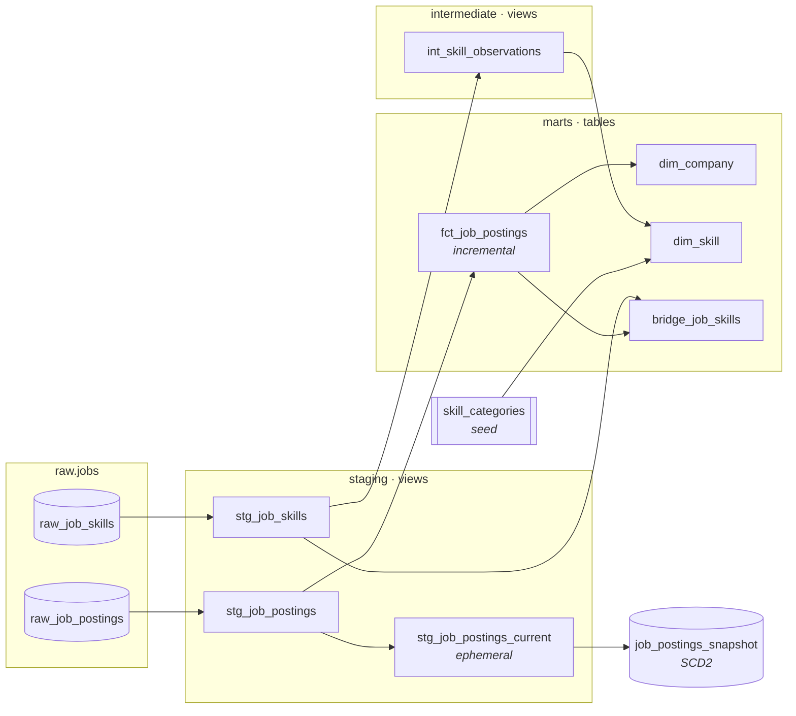

# analytics: the dbt project

The transformation layer of the [Job Postings Pipeline](../README.md). It reads raw scrapes from `raw.jobs`, cleans and parses them, and serves a tested star schema plus an SCD2 history of every posting.

📖 **Browse the docs site:** [joanasoares0.github.io/dbt-databricks-pipeline](https://joanasoares0.github.io/dbt-databricks-pipeline/) has the interactive lineage, model and column descriptions, and tests.

> Locally this runs on the **dbt Fusion engine** against the `dev` catalog. In production, the Databricks Job runs the same project against `prod`.

---

## 🧭 Lineage



---

## 🧱 Layers

| Layer | Schema | Materialization | Job |
| --- | --- | --- | --- |
| Sources | `raw.jobs` | (owned by the ingestion notebook) | Declared in [`0_sources.yml`](models/0_sources.yml). dbt only reads them and never writes. |
| Staging | `staging` | view | Filter bad rows, rename, type, and parse. One model per source table. |
| Intermediate | `intermediate` | view | Re-grain and aggregate ("staging cleans, intermediate thinks, marts serve"). |
| Marts | `marts` | table | The star schema, the only layer meant for consumers. |
| Seeds | `seeds` | table | Hand-maintained reference data. |
| Snapshots | `snapshots` | SCD2 table | Version history of posting content. |

Schema names are exactly the folder names (`staging`, not `default_staging`) thanks to the overridden [`generate_schema_name`](macros/generate_schema_name.sql). Environments are separated by **catalog** (`dev` / `prod`), not by schema prefix.

---

## 📐 Models

### Staging

| Model | Grain | What it does |
| --- | --- | --- |
| [`stg_job_postings`](models/1_staging/stg_job_postings.sql) | one row per posting **per scrape day** | Drops scraper-error rows (`error IS NOT TRUE`, 151,147 rows) and postings with no `job_id` (6,255). Parses salary text into `salary_min/max/avg`, `salary_period`, and `salary_currency`. Strips the `via ` prefix from `source_platform`. Builds `has_*` benefit flags from the extensions JSON with a Jinja loop. |
| [`stg_job_postings_current`](models/1_staging/stg_job_postings_current.sql) | one row per job as of a cutoff | **Ephemeral** input to the snapshot. Picks each job's latest row on or before `var('as_of')` (defaults to the run time), so history can be replayed day by day. |
| [`stg_job_skills`](models/1_staging/stg_job_skills.sql) | one row per (job, skill keyword) | Renames and trims, nothing more. A skill can repeat on a job (`spark`, `pyspark`). |

### Intermediate

| Model | Grain | What it does |
| --- | --- | --- |
| [`int_skill_observations`](models/2_intermediate/int_skill_observations.sql) | one row per skill | Collapses ~3.3M (job, skill) rows into a count of distinct postings per skill. |

### Marts: the star schema

| Model | Grain | What it does |
| --- | --- | --- |
| [`fct_job_postings`](models/3_marts/fct_job_postings.sql) | one row per job | **Incremental** (`merge` on `job_id`). Keeps the latest scrape per job with `QUALIFY ROW_NUMBER()`. Incremental runs only read `search_date > MAX(search_date)`. |
| [`dim_company`](models/3_marts/dim_company.sql) | one row per company | Total postings and average yearly salary. Only USD/yearly salaries are averaged, using conditional aggregation so salary-less postings still count toward the total. |
| [`dim_skill`](models/3_marts/dim_skill.sql) | one row per skill | The seed is the spine (`LEFT JOIN`), so every cataloged skill gets a row even if it was never observed. Adds display name, category, subcategory, and posting count. |
| [`bridge_job_skills`](models/3_marts/bridge_job_skills.sql) | one row per (job, skill keyword) | Resolves the many-to-many between jobs and skills. The `INNER JOIN` to the fact keeps integrity by construction. |

---

## 🧩 dbt Features Used

| Feature | How it's used |
| --- | --- |
| **Sources** | `source('jobs', 'raw_job_postings')`, pointing at a separate `raw` catalog shared by dev and prod |
| **Jinja loops** | `has_health_insurance`, `has_dental_insurance`, etc. come from one list in `stg_job_postings`, so adding a flag is a one-line edit |
| **Custom macros** | [`parse_salary(part)`](macros/parse_salary.sql) handles en-dash ranges, single values, `K`/`M` suffixes, commas, and decimals, using `TRY_CAST` so unseen shapes become null instead of failing under ANSI mode. [`slugify(text)`](macros/slugify.sql) names the flag columns. |
| **Overriding a built-in** | [`generate_schema_name`](macros/generate_schema_name.sql): schemas land exactly where the config says |
| **Packages** | [`dbt_utils`](packages.yml) |
| **Seeds** | [`skill_categories.csv`](seeds/skill_categories.csv): 1,422 skills mapped to a display name, category, and subcategory |
| **Ephemeral models** | `stg_job_postings_current` is inlined into the snapshot's SQL and never lands in the warehouse |
| **Incremental models** | `merge` strategy, `unique_key='job_id'`, `is_incremental()` high-water filter |
| **Snapshots** | SCD2, `check` strategy, `updated_at: searched_at` so validity windows carry *data* time, not run time |
| **Variables** | `--vars 'as_of: 2025-08-01'` replays the snapshot as of any day; analyses accept `job_title` |
| **persist_docs** | model and column descriptions are pushed into Unity Catalog, so they appear in Catalog Explorer |
| **Analyses** | compiled-only SQL for business questions, version-controlled next to the models |

---

## ✅ Tests

`dbt build` runs every test right after the model it covers. A failure stops that model's downstream models.

| Type | Where | Examples |
| --- | --- | --- |
| **Generic** | properties YAMLs | `unique` + `not_null` on every primary key. `relationships` from fact → `dim_company` and from bridge → fact / `dim_skill`. `accepted_values` on `search_term` and `job_schedule_type`. |
| **Custom generic** | [`tests/generic/non_negative.sql`](tests/generic/non_negative.sql) | Applied to `salary_min` and `salary_max` |
| **Singular** | [`tests/assert_salaries_sane.sql`](tests/assert_salaries_sane.sql) | Flags USD yearly salaries of ≥ $1M. Severity is `warn`: it catches 27 ranges ending in a typed "1M" ceiling. That's a known data issue, not a broken pipeline. |

The fix shaped by this test: the first version flagged 7,232 rows across *all* currencies, but ₹, ZAR, PKR, and others legitimately reach seven figures. Pinning the test to USD fixed the test's assumption instead of changing the data.

---

## 📸 Snapshots

[`job_postings_snapshot`](snapshots/snapshots.yml) keeps every version of a posting's **content**:

- `strategy: check` on 13 columns: title, company, location, schedule, remote flag, salary min/max/period/currency, and the four benefit flags
- Scrape metadata (`searched_at`, `search_*`) is left out of `check_cols` on purpose, because it changes on every re-scrape and would version every row
- `updated_at: searched_at` means `dbt_valid_from` / `dbt_valid_to` reflect when the change appeared in the data
- The current version has `dbt_valid_to IS NULL`

**Backfill:** [`../scripts/backfill_job_postings_snapshot.sql`](../scripts/backfill_job_postings_snapshot.sql) rebuilds a year of daily history in one query, by fingerprinting the watched columns and collapsing unchanged runs. After that, `dbt snapshot` carries on as if it had run every day.

---

## 🔍 Analyses

Compiled with `dbt compile` and run in the SQL editor. They're never materialized.

| Analysis | Question |
| --- | --- |
| [`in_demand_skills`](analyses/in_demand_skills.sql) | Which skills appear in the most postings? (`--vars 'job_title: Data Analyst'` to scope) |
| [`top_skills_by_salary`](analyses/top_skills_by_salary.sql) | Which skills pay the most? (USD, yearly) |
| [`optimal_skills`](analyses/optimal_skills.sql) | Which skills are both in demand **and** well paid? (100-posting floor) |
| [`top_posting_editors`](analyses/top_posting_editors.sql) | Which companies edit their postings the most? (from the snapshot) |
| [`salary_swings`](analyses/salary_swings.sql) | Which postings had the biggest salary changes between versions? |
| [`jinja_practice`](analyses/jinja_practice.sql) | Scratchpad where `slugify` was tested before reaching a model |

---

## 💻 Commands

```bash
dbt deps                                   # install dbt_utils
dbt debug                                  # check the Databricks connection
dbt build                                  # seeds + models + snapshots + tests, in DAG order
dbt build --select +dim_skill              # one model and everything upstream of it
dbt snapshot --vars 'as_of: 2025-08-01'    # replay the snapshot as of a given day
dbt compile --select optimal_skills        # render an analysis to target/compiled/
dbt docs generate && dbt docs serve        # browse lineage + descriptions locally
```

> **Tip:** use `dbt build` rather than `dbt run`. It loads seeds first, so `dim_skill` never runs against a missing `seeds.skill_categories` table.

---

## 📁 Layout

```text
analytics/
├── dbt_project.yml          # layer → schema + materialization config
├── packages.yml             # dbt_utils
├── models/
│   ├── 0_sources.yml
│   ├── 1_staging/           # stg_* + staging.yml
│   ├── 2_intermediate/      # int_* + intermediate.yml
│   └── 3_marts/             # fct_*, dim_*, bridge_* + marts.yml
├── snapshots/               # snapshots.yml (YAML-defined snapshot)
├── seeds/                   # skill_categories.csv + seeds.yml
├── macros/                  # parse_salary, slugify, generate_schema_name
├── tests/                   # singular tests + generic/
└── analyses/                # business questions + analyses.yml
```
